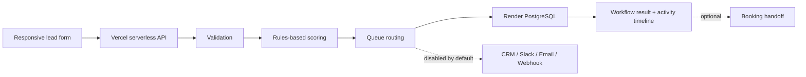

# HelioGrid Energy — Lead Automation Sandbox

## Overview

HelioGrid is a portfolio demonstration of an inbound lead workflow for a digital-services business. It shows how a contact form can validate a request, score it with transparent rules, route it to a queue, and save an auditable result without claiming that unavailable integrations are running.

**Live demo:** https://heliogrid-energy.themglabs.com

## Problem

Small teams can lose inquiries when they manually triage every form submission. A useful automation should standardize qualification and routing while making the outcome observable and avoiding accidental emails, CRM writes, or webhook calls during a public demo.

## Solution

- Capture a test inquiry through a responsive HTML form.
- Show a visible test-data disclaimer and reject honeypot-filled submissions to filter basic bots.
- Validate the required name, email, service, budget, and timeline on both client and server.
- Calculate a deterministic qualification score using budget, timeline, service, and message length.
- Assign a lead tier (Hot, Warm, or Nurture) and route the result to the MG Labs Co. — New Business queue.
- Persist the completed workflow to Render PostgreSQL before returning success.
- Show the workflow ID and integration statuses in the activity timeline.
- Keep CRM, Slack, email, and webhook side effects disabled in sandbox mode; show booking as unavailable until a URL is configured.

## Architecture

## Technology

- **Frontend:** HTML, CSS, vanilla JavaScript
- **API:** Node.js serverless function on Vercel
- **Persistence:** Render PostgreSQL via server-side `DATABASE_URL`
- **Quality checks:** Node test runner, JavaScript syntax checks, GitHub Actions CI
- **Deployment:** Vercel Preview for verification; production domain on Vercel

## Verification evidence

The final merged release was tested in a browser on the production domain:

- Form loaded successfully and displayed the sandbox label.
- Empty name and malformed email were rejected by browser validation.
- A honeypot-filled submission was rejected without completing the workflow.
- A valid sample submission rendered the qualification and routing timeline.
- The test lead received a score of **68/100 (Warm)** and was assigned to **MG Labs Co. — New Business**.
- Render PostgreSQL contained the corresponding row with `mode=sandbox` and `workflow_status=sandbox_completed`.
- HubSpot, Slack, email, and webhook statuses remained disabled in sandbox mode.
- Booking remained disabled because no booking URL was configured.
- The 390px mobile viewport had no horizontal overflow, and the browser console had no JavaScript errors.
- The Node test suite and syntax checks passed in CI.

These are verification results for sample data, not claims about production conversion rates, response-time improvements, or business outcomes.

## Safety and limitations

- Lead scoring is **rules-based**, not generated by an AI model.
- The public demo should use fictional contact details only; do not submit sensitive or real customer data.
- A honeypot helps reject basic bots, but edge rate limiting and stronger bot protection are still recommended before broad promotion.
- External integrations are intentionally off in sandbox mode and require explicit environment switches plus provider credentials.
- Add a retention policy and privacy notice appropriate to the intended public use.
- The workflow persists the final state, not a durable event for every individual step.

## Next steps

1. Configure edge rate limiting and stronger bot protection.
2. Decide a retention period for demo lead records.
3. Configure dedicated test accounts before exercising any external integration.
4. Add durable per-step workflow events if detailed operational auditing is required.
