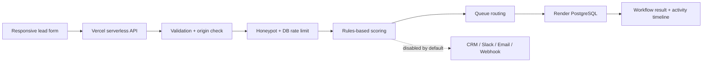

# HelioGrid Energy — Lead Automation Sandbox

**Live demo:** https://heliogrid-energy.themglabs.com

## Overview

HelioGrid is a portfolio demonstration of an inbound lead workflow for a digital-services business. It shows how a contact form can validate a request, score it with transparent rules, route it to a queue, and save an auditable result without claiming that unavailable integrations are running.

## Problem

Small teams can lose inquiries when they manually triage every form submission. A useful automation should standardize qualification and routing while making the outcome observable and avoiding accidental emails, CRM writes, or webhook calls during a public demo.

## Solution

- Capture a test inquiry through a responsive HTML form.
- Display a test-data disclaimer and reject honeypot-filled submissions to filter basic bots.
- Validate required fields on both client and server.
- Calculate a deterministic qualification score from budget, timeline, service and message length.
- Assign a lead tier (Hot, Warm or Nurture) and route the result to the MG Labs Co. — New Business queue.
- Persist the completed workflow to Render PostgreSQL before returning success.
- Show the workflow ID and integration statuses in the activity timeline.
- Keep CRM, Slack, email and webhook side effects disabled in sandbox mode.
- Clear only browser-local activity history from the UI; it does not delete shared database records.

## Architecture

## Technology

- **Frontend:** HTML, CSS, vanilla JavaScript
- **API:** Node.js serverless function on Vercel
- **Persistence:** Render PostgreSQL via server-side `DATABASE_URL`
- **Quality checks:** Node test runner, syntax checks, GitHub Actions CI
- **Deployment:** Vercel production domain

## Verification

A prior production browser test verified a valid sample submission, rules-based score, queue assignment, workflow ID, and persisted sandbox record. It also verified empty/invalid input handling, honeypot rejection, disabled integrations, booking-unavailable behavior and a 390px mobile layout without horizontal overflow. Those checks were performed before the current operational-hardening changes.

The hardening branch adds automated checks that can run without creating a lead:
- Homepage, sandbox disclosure, JavaScript bundle and security headers.
- API method guard and CORS preflight.
- Invalid input and honeypot rejection before database writes.
- Unit tests for the protected retention endpoint.
- A scheduled GitHub Actions production smoke check every six hours, in addition to CI tests and syntax checks.

A passing deployment status or safe smoke test does not replace a manual valid-submit browser test after deployment. The current branch's CI and production smoke workflow must pass after merge to validate the new release.

## Security and operations

- Database-backed rate limit: 10 accepted attempts per client IP hash per 15-minute window; only a SHA-256 hash is stored.
- Vercel headers include Content Security Policy, frame denial, MIME-sniffing protection, referrer policy and restricted browser permissions.
- Daily retention job deletes sandbox leads older than **30 days** and rate-limit rows older than **7 days**. It requires the Vercel Production environment variable `CRON_SECRET`.
- CRM, Slack, email and webhook integrations remain disabled by default; booking stays unavailable until configured.
- The public API does not expose a visitor-facing list of other leads.
- The Render database currently runs on a free plan without high availability and has a displayed expiry date of **15 November 2026**. Upgrade or migrate before then if the public demo needs to stay online.
- The current database network allowlist accepts all source IPs because Vercel serverless egress is not fixed in this setup. Database credentials and TLS still apply, but this is not the desired long-term posture for real customer data.
- Configure and test backups/recovery before relying on the service for business-critical data.

## Limitations

- Lead scoring is rules-based, not generated by an AI model.
- The public demo should use fictional contact details only; do not submit sensitive or real customer data.
- A honeypot and app-level rate limit help reduce abuse but are not a replacement for managed edge bot protection or CAPTCHA.
- The browser's recent activity panel is local to that browser and is not a shared operational dashboard.
- The workflow stores final state, not a durable event for every individual step.
- The 30-day sandbox retention job is not a substitute for a full privacy notice, consent flow or legal review for a real service.

## Next steps before real business use

1. Upgrade/migrate the Render database before its expiry and configure recovery.
2. Configure static egress/private networking or a managed database connection strategy.
3. Add managed bot protection (for example, Turnstile) after site/secret keys are provisioned.
4. Enable external integrations only with dedicated test accounts and explicit approval of their side effects.
5. Add durable per-step events and operational alerting appropriate to the expected traffic.
